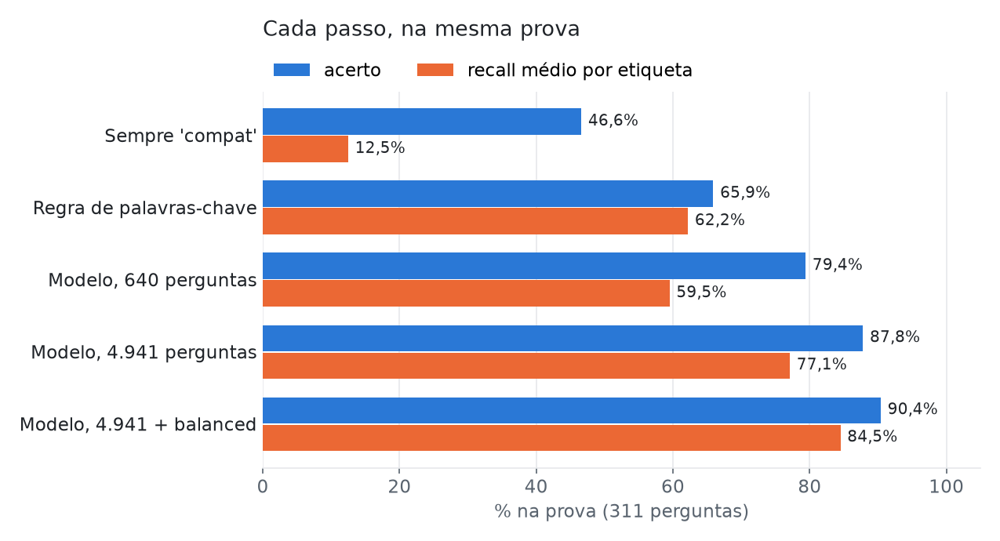
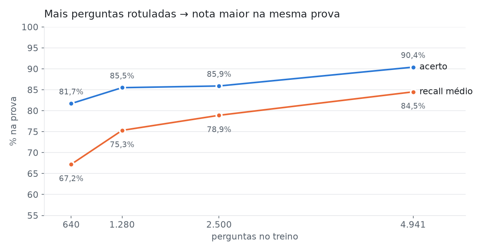

# Classificador de perguntas de compradores do Mercado Livre

Modelo de machine learning que lê a pergunta de um comprador num anúncio de autopeças e diz de que **tipo** ela é,
para quem atende responder mais rápido, com respostas prontas por tipo. Está em uso no sistema interno da empresa
onde trabalho.

> **Sobre os dados:** as perguntas reais são de compradores e da empresa, e **não** estão neste repositório. A
> pasta `dados/` tem um **exemplo inventado**, no mesmo formato, para o notebook rodar de ponta a ponta. Os
> números deste README são os dos dados reais; rodando com o exemplo, você vai ver outros.

## O problema

As lojas da empresa no Mercado Livre recebem milhares de perguntas, e metade delas é a mesma: *"serve no meu
carro?"*. O resto se divide em lado da peça, o que vem no kit, medida, outra peça, pedido já feito, preço e envio,
e conversa (bom dia, obrigado). Saber o tipo antes de ler permite sugerir a resposta certa e mostrar quais anúncios
recebem mais perguntas de compatibilidade — sinal de título ou descrição que não está deixando isso claro.

| etiqueta | exemplo inventado |
|---|---|
| `compat` | serve no Gol 2015? |
| `lado` | é o lado do motorista? |
| `conteudo` | vem com as presilhas? |
| `medida` | qual o diâmetro do furo? |
| `outra_peca` | tem para o Civic 2008? |
| `pedido` | meu pedido não chegou |
| `preco_envio` | qual o valor do frete? |
| `outros` | boa tarde, obrigado |

## Os dados e a rotulação

5.252 perguntas reais, rotuladas nas 8 etiquetas, com a **origem de cada rótulo registrada**, porque eles não têm a
mesma qualidade:

| origem | quantas | quem rotulou |
|---|---|---|
| `gabarito` | 801 | sugestão de um assistente de IA (Claude), revisada por mim uma por uma |
| `cega_consenso` | 150 | eu e o assistente, **sem ver um ao outro**; divergências decididas juntos |
| `claude` | 4.301 | o assistente, seguindo as regras combinadas, sem revisão linha a linha |

As regras de fronteira foram combinadas antes de rotular em escala (por exemplo: *"vem com…"* é `conteudo`, não
`compat`; continuação de conversa é `outros`).

**A prova usa só os rótulos confiáveis:** as 150 cegas + 20% do gabarito (estratificado) = **311 perguntas**. Os
rótulos só do assistente vão todos para o treino (4.941). Se fossem para a prova, ela mediria "o modelo concorda
com o assistente?", e não "o modelo acerta?".

## O modelo

```python
make_pipeline(
    TfidfVectorizer(analyzer='char_wb', ngram_range=(2, 5), sublinear_tf=True,
                    strip_accents='unicode', lowercase=True, min_df=2),
    LogisticRegression(C=10, class_weight='balanced', max_iter=3000),
)
```

- **Pedaços de letras (2 a 5)**, não palavras: aguenta erro de digitação ("servi", "corola") e abreviação, que é
  como pergunta se escreve no celular.
- **`class_weight='balanced'`**: metade das perguntas é `compat` e a etiqueta mais rara tem 117. Sem peso, o
  modelo aprende a acertar `compat` e erra as raras. Testei também jogar fora parte dos `compat`; o peso ganhou.
- **Regressão logística**: rápida, explicável e com probabilidade calibrada o bastante para decidir quando pedir
  um olho humano (ver "Confiança").

## Resultados (na mesma prova de 311 perguntas)



| | acerto | recall médio por etiqueta |
|---|---|---|
| sempre `compat` | 46,6% | 12,5% |
| regra de palavras-chave | 65,9% | 62,2% |
| modelo, 640 perguntas | 79,4% | 59,5% |
| modelo, 4.941 perguntas | 87,8% | 77,1% |
| **modelo, 4.941 + balanced** | **90,4%** | **84,5%** |

O **recall médio** dá o mesmo peso a cada etiqueta; é a nota que mostra se o modelo acerta as raras e não só o
`compat`. Trocando a semente do sorteio da prova, o acerto fica entre **88% e 91%** — essa faixa é a resposta
honesta, não um número só.

### Curva de aprendizado



A curva ainda sobe no fim: rotular mais perguntas ainda ajuda.

### O teto: quanto concordam duas pessoas

| comparação (150 cegas) | concordam |
|---|---|
| eu × assistente | 84,0% |
| modelo × eu | 81,3% |
| modelo × assistente | 90,7% |

Duas pessoas (ou uma pessoa e um assistente) discordam em 16% das perguntas, então nenhum modelo vai acertar 99%:
parte das perguntas tem dois assuntos ou fronteira discutível. E o modelo concorda mais com quem rotulou a maior
parte do treino — ele aprende também o **estilo** do rotulador, não só a tarefa.

### Confiança

| confiança do modelo | perguntas | acerto |
|---|---|---|
| até 50% | 20 | 65% |
| 50–70% | 46 | 70% |
| 70–90% | 71 | 87% |
| **acima de 90%** | **174** | **100%** |

Acima de 90% de confiança o modelo não errou nenhuma das 174 perguntas da prova. Abaixo disso, a tela mostra a
etiqueta com um "?" para ninguém usar a resposta pronta no automático.

## Privacidade: `min_df=2`

O vocabulário do modelo é exportado para o sistema da empresa. Com `min_df=1`, ele guardava os pedaços de **todas**
as perguntas, inclusive das que aparecem uma vez só — e em 12 perguntas com CEP ou telefone, todos os pedaços do
número estavam lá: encaixando-os, dava para remontar o número. Com `min_df=2` (o pedaço precisa aparecer em pelo
menos duas perguntas), nenhuma. Custou 0,6 ponto de acerto e deixou o arquivo com metade do tamanho.

## Do notebook para produção

O sistema da empresa roda em TypeScript (Cloudflare Workers), não em Python. O modelo vai para lá como **JSON**
(Passo 16 do notebook): para cada pedaço de letras, a raridade (IDF) e um peso por etiqueta. Do lado do
TypeScript, a conta do `predict_proba` do scikit-learn é refeita passo a passo — minúsculas, tirar acento, cortar
em pedaços, TF-IDF com norma L2, regressão logística e softmax.

Copiar a conta entre linguagens tem armadilhas que não dão erro, só etiqueta errada: um emoji é um caractere no
Python e dois no JavaScript; o `str.split()` do Python considera espaço caracteres que o `\s` do JavaScript não
considera; e a remoção de acento do scikit-learn não é a mesma coisa que `\p{Mn}`. Por isso o notebook exporta
também um arquivo de **conferência** (perguntas inventadas + a resposta do Python), e um teste no TypeScript exige
a mesma etiqueta e a mesma probabilidade. Conferido nas 5.462 perguntas reais: **nenhuma etiqueta trocada**,
diferença máxima de probabilidade de 0,0000027, e 0,1 ms por pergunta.

Na tela de atendimento, a etiqueta aparece ao lado da pergunta com as respostas prontas daquele tipo. O atendente
confirma ou corrige a etiqueta, e essas confirmações (só o id da pergunta e a etiqueta, nunca o texto) viram dado
de treino para a próxima versão. Nada confirma sozinho: o modelo não aprende com o próprio chute.

A tabela dessas confirmações está em [`sql/confirmacoes.sql`](sql/confirmacoes.sql), com uma consulta que mede o
acerto em produção por versão do modelo e por faixa de confiança — a mesma tabela do Passo 14, só que nas
perguntas novas.

*O código do sistema da empresa não está neste repositório.*

## Como rodar

**No Google Colab:** abra `classificador_perguntas.ipynb`, crie uma pasta `dados` na aba Arquivos, arraste os dois
CSVs de `dados/` para ela e rode célula por célula.

**Local:**

```bash
pip install -r requirements.txt
jupyter notebook classificador_perguntas.ipynb
# ou só treinar e exportar:
python treinar.py dados/rotulos_exemplo.csv
```

## Arquivos

| arquivo | o que é |
|---|---|
| `classificador_perguntas.ipynb` | o projeto inteiro, passo a passo e comentado (16 passos) |
| `treinar.py` | treino e exportação do modelo em JSON, sem o notebook |
| `dados/rotulos_exemplo.csv` | perguntas **inventadas** com etiqueta, no formato dos dados reais |
| `dados/perguntas_exemplo.csv` | perguntas **inventadas** sem etiqueta, para o Passo 15 |
| `sql/confirmacoes.sql` | a tabela das confirmações (PostgreSQL) e a consulta de acerto em produção |
| `gerar_exemplo.py` | o script que inventou os dados de exemplo |
| `imagens/` | os gráficos deste README, com os números reais agregados |

## Ferramentas

Python, pandas, scikit-learn 1.6.1, matplotlib, Google Colab; TypeScript, Vitest e PostgreSQL no lado de produção. A
rotulação e boa parte do código foram feitos em par com um assistente de IA (Claude), e isso está registrado na
coluna `origem` dos dados.
